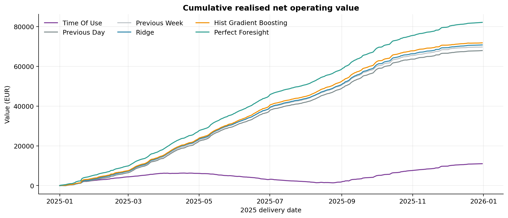
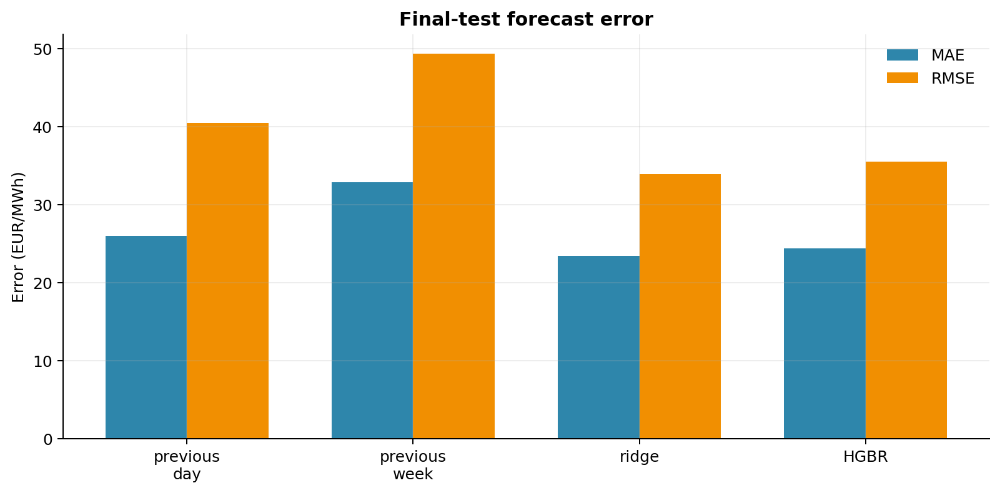
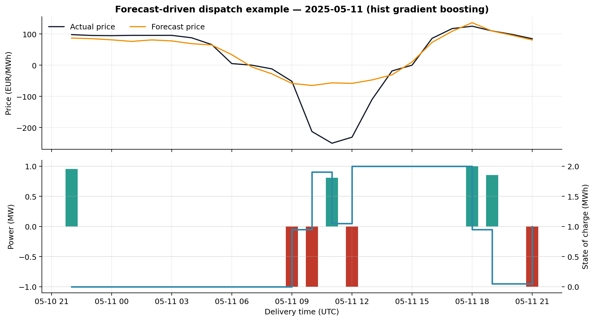
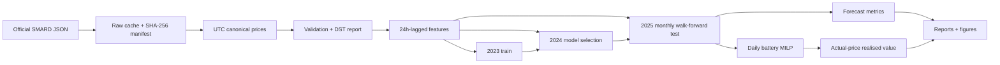
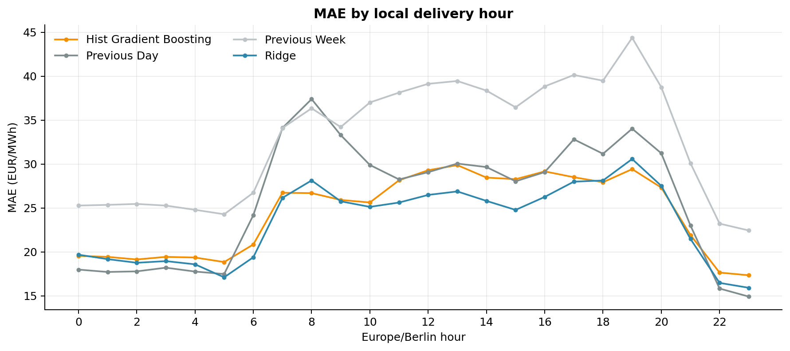

# European Power Market Forecasting & Battery Storage Optimisation

[](https://github.com/000zer000/european-power-market-research-platform/actions/workflows/ci.yml)

Can a leakage-free day-ahead price forecast improve the realised market value of a battery schedule, or does a simple seasonal rule work just as well?

This repository answers that question for the German–Luxembourg (`DE-LU`) day-ahead market using official 2023–2025 prices, a chronologically isolated 2025 test set, four forecast methods, and a mixed-integer battery scheduler. It connects price accuracy to actual-price settlement instead of treating MAE as the final objective.

The main result is deliberately not a simple “best model” claim: **Ridge had the lowest 2025 price error, while histogram gradient boosting created the highest forecast-driven battery value.** Price accuracy and decision value were related, but not identical.



## Measured results

All numbers below come from the committed machine-readable outputs. Hyperparameters were chosen on 2024; 2025 was not consulted during model selection.

### Forecasting — final 2025 test set

| Method | MAE (EUR/MWh) | RMSE (EUR/MWh) | Direction vs previous day |
|---|---:|---:|---:|
| Previous day | 25.965 | 40.446 | not applicable |
| Previous week | 32.830 | 49.332 | 64.09% |
| **Ridge** | **23.375** | **33.852** | **64.47%** |
| Histogram gradient boosting | 24.380 | 35.512 | 64.28% |

Ridge reduced MAE by **9.98%** against the strongest seasonal MAE baseline (previous day). The paired local-day bootstrap estimated the Ridge-minus-baseline MAE difference at **-2.595 EUR/MWh**, with a 95% interval of **[-3.822, -1.408]**. Histogram gradient boosting's interval was **[-3.233, -0.071]**.

The result is not universal across regimes: on the 573 negative-price test hours, previous day had lower MAE (27.079) than Ridge (32.076) or histogram gradient boosting (34.075). See [`forecast_metrics.json`](artifacts/metrics/forecast_metrics.json) for the full slices.



### Battery backtest — 2 MWh / 1 MW default battery

| Scheduling strategy | Gross market revenue (EUR) | Degradation cost (EUR) | Net operating value (EUR) | Equivalent full cycles | Gap to perfect foresight (EUR) |
|---|---:|---:|---:|---:|---:|
| Perfect foresight | 87,453.87 | 5,339.58 | **82,114.29** | 667.45 | 0.00 |
| **Histogram gradient boosting** | 77,288.19 | 5,486.21 | **71,801.98** | 685.78 | 10,312.31 |
| Ridge | 75,721.33 | 4,960.32 | 70,761.02 | 620.04 | 11,353.27 |
| Previous week | 75,029.14 | 5,308.39 | 69,720.75 | 663.55 | 12,393.54 |
| Previous day | 73,273.82 | 5,339.18 | 67,934.64 | 667.40 | 14,179.65 |
| Time of use | 13,925.39 | 2,920.00 | 11,005.39 | 365.00 | 71,108.90 |
| Do nothing | 0.00 | 0.00 | 0.00 | 0.00 | 82,114.29 |

Histogram gradient boosting increased modeled net operating value by **EUR 3,867.34 (5.69%)** over previous-day scheduling and captured **87.44%** of the perfect-foresight upper bound. Ridge's better MAE did not translate into the best value: the nonlinear model more often selected economically useful constrained charge/discharge intervals.

“Net operating value” means realised day-ahead market revenue minus a EUR 2/MWh internal-cell-throughput charge. It is **not accounting profit**. Capex, market fees, imbalance settlement, taxes, bidding restrictions and other operating costs are excluded.



## What the platform does

- downloads and caches official price payloads;
- records exact URLs, retrieval times, request parameters, units and SHA-256 hashes;
- keeps unique timezone-aware UTC keys and derives `Europe/Berlin` market features;
- validates gaps, duplicates, intervals, non-finite values, schema changes, negative prices and 23/25-hour DST days;
- builds price features lagged by at least 24 delivery hours and audits them automatically;
- selects Ridge and histogram gradient boosting settings on 2024 only;
- produces deterministic monthly expanding-window forecasts for the untouched 2025 test year;
- reports MAE, RMSE, a directional metric, local-hour/month slices, negative/extreme-price slices and daily block-bootstrap intervals;
- schedules a battery with a SciPy/HiGHS mixed-integer program that forbids simultaneous charging and discharging;
- settles forecast-chosen schedules against actual prices and checks the perfect-foresight bound;
- generates reproducible metrics, dispatch tables, a research summary and eight publication-quality figures.

## Architecture



The important separations are enforced in code: raw versus processed data, historical features versus targets, validation versus test, scheduling prices versus realised prices, and solver output versus an independent physical audit. A detailed map is in [`docs/architecture.md`](docs/architecture.md).

## Data source, licence and time convention

The executed run uses Bundesnetzagentur's public [SMARD data](https://www.smard.de/en/downloadcenter), hourly series `4169`, for local delivery dates **2023-01-01 through 2025-12-31**. Prices are EUR/MWh. SMARD market data are licensed [CC BY 4.0](https://www.smard.de/en/datennutzung); attribution is **Bundesnetzagentur | SMARD.de**.

Fraunhofer ISE's documented [Energy-Charts `/price` API](https://api.energy-charts.info/) was the preferred adapter but returned HTTP 503 throughout the 2026-08-03 execution window. The code supports its documented schema; the executed analysis uses the live authoritative SMARD source and records that choice honestly.

European day-ahead products changed from 60-minute to 15-minute market time units on 2025-10-01. This study uses SMARD's official hourly series to maintain a uniform hourly battery decision interval; it does not claim intrahour value after that transition. See [`docs/data_and_provenance.md`](docs/data_and_provenance.md).

The validation run found **26,304** continuous UTC hours, **1,331** negative-price observations, no missing/duplicate/non-finite rows, three 23-hour spring days and three 25-hour autumn days. No observation was interpolated, clipped, imputed, silently dropped or deduplicated.

## Leakage-safe experiment

Every calendar feature is known before delivery. Every price feature is shifted by at least 24 elapsed hours:

- previous-day price: UTC lag 24;
- previous-week price: UTC lag 168;
- 24-hour historical mean: calculated after a 24-hour shift;
- 168-hour mean and standard deviation: calculated after a 24-hour shift.

UTC lags remain unambiguous across DST. Hyperparameter grids are evaluated on 2024, frozen, and then used in a monthly expanding-window 2025 simulation. Tests mutate future targets and prove that earlier feature rows do not change. Full rationale: [`docs/methodology.md`](docs/methodology.md).



## Battery formulation

For charge/discharge power measured at the grid meter:

\[
s_{t+1}=s_t+\eta_c c_t\Delta_t-\frac{d_t}{\eta_d}\Delta_t.
\]

The MILP enforces power and energy limits, separate one-way efficiencies, daily initial/terminal SoC equality, and binary mode constraints:

\[
c_t\le P_c y_t,\qquad d_t\le P_d(1-y_t),\qquad y_t\in\{0,1\}.
\]

The binary mode is necessary because a relaxed model can exploit negative prices through simultaneous lossy charge/discharge. An independent post-solve audit reconstructs every state transition, bound, endpoint, exclusivity condition and objective. Full units and objective: [`docs/battery_optimisation.md`](docs/battery_optimisation.md).

## Reproduce

Python 3.11 or newer is required. The exact runtime lock is provided.

```bash
python3.11 -m venv .venv
source .venv/bin/activate
python -m pip install --upgrade pip
python -m pip install -r requirements.lock
python -m pip install -e . --no-deps
power-market --config configs/default.yaml run-all
```

The first run downloads official weekly responses; later runs use the raw cache. Add `--force` to replace it. For a network-free deterministic demonstration:

```bash
power-market --config configs/offline.yaml run-all
```

Individual stages are `fetch-data`, `validate-data`, `build-features`, `train`, `evaluate`, `optimise`, `report` and `run-all`. Configuration is validated before execution; unknown YAML keys and physically inconsistent batteries fail fast.

## Tests and quality

```bash
ruff check .
ruff format --check .
mypy src
pytest --cov=power_market --cov-report=term-missing --cov-fail-under=85
```

Tests cover API parsing, schema changes, nullable and negative values, cache provenance, gaps/duplicates, both DST transitions, leakage invariants, split isolation, deterministic models, metrics, state equations, efficiencies, terminal SoC, binary exclusivity, degradation, actual-price settlement, perfect-foresight bounds, 23/25-interval optimization and an offline end-to-end run.

The 1 November 2026 verification passed **81 tests with 90.98% branch coverage**, including adversarial schedules and a complete offline pipeline. The earlier 37-test gate remains part of the historical record.

The [battery-audit verification](docs/BATTERY_AUDIT_2026-11-01.md) independently rechecks all 2,555 published daily schedules and reconciles their accounting. All published values remain unchanged.

GitHub Actions runs linting, formatting, strict type checking and the test/coverage gate on Python 3.11 and 3.12, plus Gitleaks secret scanning and Lychee documentation link checking.

## Evidence and repository structure

```text
configs/                     validated real and offline YAML
src/power_market/            tested ingestion, forecasting, optimisation and reporting
tests/                       unit, integration, leakage and physical-property tests
data/raw/                    ignored byte-for-byte response cache
data/processed/              reproducible local canonical and feature tables
artifacts/provenance/        source and feature-availability manifests
artifacts/validation/        explicit data-quality report
artifacts/metrics/           selection, predictions, metrics and error slices
artifacts/backtests/         interval, daily, aggregate and sensitivity evidence
artifacts/figures/           eight committed static figures
reports/                     generated concise research summary
docs/                        design, methodology, limitations and defense guide
```

Start an evidence audit at [`docs/results.md`](docs/results.md). For interview preparation, use [`docs/PROJECT_DEFENSE_GUIDE.md`](docs/PROJECT_DEFENSE_GUIDE.md), which contains the code map, presentations, 35 questions and ten exercises with solutions.

## Limitations

- The post-October-2025 market is hourly aggregated; quarter-hour dispatch is outside scope.
- Only price/calendar history is modeled; no load, renewable, fuel or outage forecasts are included.
- Daily terminal equality excludes cross-midnight energy carry.
- Degradation is linear internal throughput, not an electrochemical model.
- The battery is a price taker with perfect availability; bid rules, fees, imbalance and latency are absent.
- One zone and three years do not establish performance across Europe or future regimes.

The complete claim boundary is in [`docs/limitations.md`](docs/limitations.md).

## Implemented next steps, versus future work

Implemented here: official ingestion, validation, leakage-safe tabular forecasting, monthly walk-forward evaluation, daily mixed-integer scheduling, actual-price settlement, uncertainty, sensitivity, figures, CLI, tests and CI.

Defensible future work would model quarter-hour delivery after October 2025, add publication-time-stamped load/wind/solar forecasts, allow cross-day SoC with a longer optimization horizon, and encode actual exchange/balancing rules. None of those are claimed as present.

## Licence

Code and original documentation are MIT licensed. SMARD source data and data-derived evidence retain CC BY 4.0 attribution. No employer or confidential data are used.
