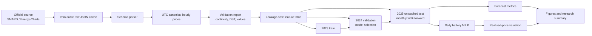

# Architecture

The repository is a small research platform, not a notebook pipeline. The command line and optional explanatory material call the same tested package.

## Boundaries

- `config.py` validates YAML before work begins.
- `data.py` owns network access, raw caching, parsing, hashes and the canonical UTC table.
- `validation.py` detects data problems and refuses to repair them silently.
- `features.py` owns the feature-availability contract and chronological split labels.
- `forecasting.py` selects hyperparameters on validation data and creates monthly expanding-window test forecasts.
- `metrics.py` owns forecast evaluation and day-block confidence intervals.
- `battery.py` contains the solver formulation and an independent post-solve audit.
- `backtest.py` keeps scheduling prices separate from realised valuation prices.
- `reporting.py` reads saved evidence and makes static recruiter-facing outputs.
- `pipeline.py` composes stages; `cli.py` is only a thin interface.

This separation makes the dangerous boundaries visible: raw versus processed data, features versus targets, validation versus test, forecast prices versus realised prices, and solver output versus independent physical checks.

## Data lifecycle

Raw JSON is cached under `data/raw/` and ignored by Git. The canonical price and feature CSV files under `data/processed/` are reproducible local products and are also not required for repository review. Small machine-readable evidence, reports and figures under `artifacts/` and `reports/` are committed. Every official response is hashed in `artifacts/provenance/manifest.json`.

## Failure policy

Unknown response keys at the SMARD top level, malformed rows, missing hours, duplicate UTC timestamps, non-finite prices, invalid local day lengths, infeasible schedules and non-optimal solver termination all stop the pipeline. Negative and zero prices are valid and preserved.
